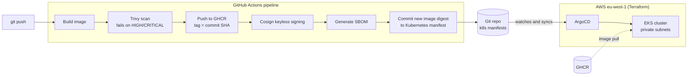

[README.md](https://github.com/user-attachments/files/34940562/README.md)
# 🛡️ Secure GitOps Platform on AWS


> From `git push` to a **scanned, signed, GitOps-deployed** container on Kubernetes. No long-lived secrets, everything as code, and an honest log of what broke along the way.

Most CI/CD portfolios stop at "it builds and deploys." This project focuses on what security-minded teams actually worry about: **the software supply chain**. Every image is vulnerability-scanned *before* it is published, signed without storing any keys, shipped with an SBOM, and deployed **by digest**, so the cluster runs exactly the bytes that were verified.

**Skills shown:** Terraform · AWS (VPC, EKS, S3, IAM) · Kubernetes · ArgoCD / GitOps · GitHub Actions · Docker · Trivy · Cosign / Sigstore · SBOMs · Dependabot · incident-style debugging

---

## Architecture




*Green `build-scan-sign` runs: the commit-SHA pinning run (#5) and the automatic manifest-update run (#4), alongside Dependabot's scheduled checks.*

---

## What's inside

| Layer | Tooling | Why it matters |
|---|---|---|
| Infrastructure | Terraform with S3 remote state and native locking | Reproducible, reviewable infrastructure |
| Network | VPC, public/private subnets, NAT | Worker nodes are never directly exposed |
| Compute | Amazon EKS (managed node group) | Real managed Kubernetes |
| Delivery | ArgoCD (auto-sync, prune, self-heal) | Git is the single source of truth |
| CI | GitHub Actions | Build, scan, sign and publish on every push |
| Scanning | Trivy | Vulnerable images never reach the registry |
| Signing | Cosign (keyless, via GitHub OIDC) | Provenance with no private keys to leak |
| Transparency | SBOM (SPDX) | Know exactly what is inside each image |
| Maintenance | Dependabot | Pinned actions and dependencies stay current |

## Security decisions

- **Scan before push.** The image is built locally on the runner, scanned, and only pushed if it passes.
- **Tags are commit SHAs, never `latest`.** Every image traces back to exactly one commit.
- **Deploy by digest.** The pipeline writes `image@sha256:...` into the manifest, so the cluster runs the exact image that was scanned and signed.
- **Keyless signing.** GitHub proves the workflow's identity to Sigstore, so there are no signing keys to store or rotate.
- **Third-party actions pinned by commit SHA**, with Dependabot proposing updates. (See "Things that broke" #4 for why.)
- **Containers run as non-root**, with resource requests, memory limits, and liveness/readiness probes.
- **No secrets in Git.** The state bucket name is passed at `terraform init`, and the pipeline only uses short-lived `GITHUB_TOKEN`s.
- **`main` is protected** against deletion and force-pushes.

### Verify a signature yourself

```bash
cosign verify ghcr.io/kingmog6/secure-gitops-platform:<commit-sha> \
  --certificate-identity-regexp "https://github.com/KingMOG6/secure-gitops-platform/.*" \
  --certificate-oidc-issuer https://token.actions.githubusercontent.com
```

Output from a real image built by this pipeline:

```text
Verification for ghcr.io/kingmog6/secure-gitops-platform:058307c1021432e92113dce906ad317f0d0a9fef --
The following checks were performed on each of these signatures:
  - The cosign claims were validated
  - Existence of the claims in the transparency log was verified offline
  - The code-signing certificate was verified using trusted certificate authority certificates
```

The signature is valid, recorded in Sigstore's public transparency log, and tied to this repository's workflow.

<!-- OPTIONAL SCREENSHOT 04: GHCR package page + SBOM artifact from a green run.
     Save as docs/img/04-packages-and-sbom.jpg, then uncomment the next two lines.

*Every build publishes a signed image to GHCR and an SBOM listing everything inside it.*
-->

---

## GitOps in action

ArgoCD watches `k8s/app` on `main` with auto-sync, prune and self-heal enabled. The pipeline's last step commits the new image digest, so a code push flows all the way to the cluster without anyone running `kubectl`.

### 1. Git change → cluster change (on EKS)

Before the pipeline existed, I proved the GitOps loop on the EKS cluster with a public nginx test image. Committing "Scale demo-app to 3 replicas" made ArgoCD sync automatically and run three healthy pods, with no `kubectl apply` for the workload.


*ArgoCD on the EKS cluster, synced to the scaling commit, with the Deployment, ReplicaSet and three running pods.*

### 2. Signed image deployed by digest

> **Where this ran:** this demo ran on a local `kind` cluster, so anyone can reproduce it at zero cost (AWS access was unavailable during this phase). The manifests and ArgoCD setup are identical to the EKS version.

ArgoCD's last sync here was authored by `github-actions[bot]`: the pipeline itself updated the manifest after signing the image.


*The commit message `ci: deploy 64dafeb` is the pipeline updating the deployment image; ArgoCD picked it up on its own.*

The running pods reference the exact digest that was scanned and signed, not a mutable tag:


And the app answers:


### 3. Drift detection and self-heal

I scaled the deployment to 1 replica by hand. ArgoCD flagged the app as `OutOfSync` and began syncing it back to the 3 replicas defined in Git. Afterwards the app returned to `Synced`/`Healthy` with 3 of 3 replicas ready.


*Manual change detected: `OutOfSync` with a sync starting.*

---

## Repository layout

```
app/                  Flask app + Dockerfile
terraform/
  bootstrap/          S3 bucket for remote state (applied once)
  network/            VPC, subnets, NAT
  eks/                EKS cluster and node group
k8s/app/              Kubernetes manifests (image digest updated by the pipeline)
argocd/               ArgoCD Application definition
.github/
  workflows/          build-scan-sign pipeline
  dependabot.yml      weekly updates for actions, Docker and pip
docs/img/             screenshots used in this README
```

## Run it yourself

### Option A: locally on kind (free, about 10 minutes)

```bash
kind create cluster --name gitops
kubectl create namespace argocd
kubectl apply -n argocd --server-side -f https://raw.githubusercontent.com/argoproj/argo-cd/stable/manifests/install.yaml
kubectl wait --for=condition=available deployment --all -n argocd --timeout=300s
kubectl apply -f argocd/demo-app.yaml
kubectl get pods -n demo -w
```

The GHCR package must be public so the cluster can pull the image without credentials.

### Option B: on AWS EKS

> ⚠️ **Cost:** EKS + nodes + NAT is roughly **$0.25/hour**. Apply, learn, destroy in the same session.

```bash
# 1. One-time: remote state bucket
cd terraform/bootstrap && terraform init && terraform apply

# 2. Network, then cluster (order matters)
BUCKET="tfstate-$(aws sts get-caller-identity --query Account --output text)-eu-west-1"
cd ../network && terraform init -backend-config="bucket=$BUCKET" && terraform apply
cd ../eks     && terraform init -backend-config="bucket=$BUCKET" && terraform apply

# 3. Connect, install ArgoCD, register the app
aws eks update-kubeconfig --region eu-west-1 --name secure-gitops
kubectl create namespace argocd
kubectl apply -n argocd --server-side -f https://raw.githubusercontent.com/argoproj/argo-cd/stable/manifests/install.yaml
kubectl apply -f argocd/demo-app.yaml

# 4. Tear down: ALWAYS cluster first, wait for it to finish, then network
cd terraform/eks && terraform destroy
cd ../network && terraform destroy
```

---

## 🔥 Things that broke (and what I learned)

Real failures from building this. Each one taught me something a tutorial wouldn't.

**1. `InvalidParameterCombination`: instance type not Free Tier eligible.**
EKS nodes failed to launch on `t3.medium` because the account was on AWS's Free plan. I listed the allowed types with `aws ec2 describe-instance-types --filters Name=free-tier-eligible,Values=true`, switched to `m7i-flex.large` (8 GB RAM), and Terraform replaced only the broken node group.
*Lesson: read the plan before applying. A small plan (`3 to add, 1 to destroy`) is safe; a plan that rebuilds the cluster is not.*

**2. `ImagePullBackOff` on every ArgoCD pod.**
Pods timed out reaching `quay.io`. The NAT gateway was gone: I had run `terraform destroy` on the network stack while the cluster still depended on it. The VPC and subnets survived because the nodes were still using them, but the internet gateway, NAT and routes were deleted. The system pods kept working because AWS hosts their images internally, which hid the problem. I traced it with `kubectl describe pod`, confirmed no NAT gateway existed with the AWS CLI, re-applied the network stack, and restarted the pods.
*Lesson: destruction order matters, and some failures stay hidden until something needs the public internet.*

**3. `DependencyViolation` when deleting subnets.**
After the cluster was destroyed, the subnets couldn't be deleted because EKS leaves network interfaces behind for a while. I inspected them with `aws ec2 describe-network-interfaces`, waited, and retried.
*Lesson: managed services clean up asynchronously. Confirm the cluster is truly gone before touching the network.*

**4. The Trivy GitHub Action had been compromised.**
My pipeline failed with `unable to find version 0.28.0`. Research showed Trivy's action had suffered a supply-chain attack in which release tags were hijacked, and the maintainers removed the affected tags. I moved to a clean, v-prefixed release and then **pinned every third-party action by commit SHA**, with Dependabot proposing updates.
*Lesson: a tag is a pointer that can be moved; a commit SHA can't. This is exactly why this project exists.*

**5. The scanner caught a real vulnerability.**
Trivy failed the build on two HIGH findings in `zlib1g`, part of the Debian base image, not in my code. All Python dependencies came back clean.

```text
Total: 2 (HIGH: 2, CRITICAL: 0)

Library  Vulnerability   Severity  Installed                    Fixed
zlib1g   CVE-2026-76844  HIGH      1:1.3.dfsg+really1.3.1-1+b1  1:1.3.dfsg+really1.3.1-1+deb13u1
zlib1g   CVE-2026-85091  HIGH      1:1.3.dfsg+really1.3.1-1+b1  1:1.3.dfsg+really1.3.1-1+deb13u1
```

I didn't weaken the scan. I added `apt-get upgrade` to the Dockerfile, and the next run went green with the Debian row at 0 vulnerabilities.
*Lesson: fix findings, don't silence the scanner. Base images lag behind security patches.*


*Run #2 failing at the scan step, so the vulnerable image was never published.*

**6. State, secrets and cost hygiene.**
The Terraform state bucket name contains the AWS account ID, so it's passed with `-backend-config` and never committed. A budget alert and a destroy-after-every-session habit kept the bill near zero.

---

**Trade-offs and what I'd change in**

Being clear about the shortcuts is part of the work:

- **One NAT gateway** instead of one per availability zone, to save cost. Production would run one per zone.
- **Public cluster endpoint** so `kubectl` works from a laptop. Production would restrict it to a VPN or approved IP ranges.
- **The pipeline commits directly to `main`** to update the image digest, which is why only light branch protection (no deletion, no force-push) is enabled. A stricter setup would let the pipeline open a pull request or keep deployment manifests in a separate config repository.
- **Signatures are verified by hand**, not enforced by the cluster yet. That is the next step on the roadmap.
  
> **A note on the screenshots:** some images are photos of my laptop screen taken with a phone. Nothing is edited apart from cropping and hiding my email address. Everything shown can be checked live: see "Verify it yourself" below.


  ## Verify it yourself

You don't have to take my screenshots on trust:

- **Pipeline history:** every run is public in this repo's **Actions** tab, including the failed Trivy run (#2).
- **Signature:** run the `cosign verify` command above against any published image. It checks the signature against Sigstore's public transparency log.
- **Image and SBOM:** the container image is public under this repo's **Packages**, and each green run has an SBOM artifact.
- **Commit history:** commits by `github-actions[bot]` (`ci: deploy ...`) show the pipeline updating the manifest on its own.

Next steps for this project

- [ ] Enforce Cosign signatures at cluster admission, so unsigned images are rejected
- [ ] Run the signed-image demo end to end on EKS
- [ ] Open pull requests for manifest updates instead of committing directly to `main`
